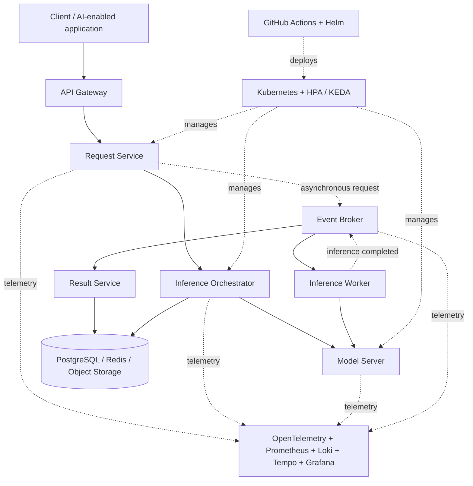

# AI-Ready Cloud Application Platform for Intelligent Distributed Services

A reusable, cloud-native foundation for building, deploying, scaling and observing AI-enabled distributed applications.

> **Project stage:** Requirements and architecture design completed; implementation and evaluation are the next phases. This repository separates completed design work from planned implementation so progress is transparent.

## Overview

AI-enabled applications often combine microservices, APIs, machine-learning inference, asynchronous processing and persistent data. Building these capabilities separately for every application can lead to inconsistent deployment, scaling, monitoring and failure recovery.

This project proposes a reusable platform that brings these capabilities together using containers and Kubernetes.

## Problem statement

Teams often rebuild infrastructure to run ML-enabled services. As a result, models can be difficult to integrate, scale, monitor and deploy reliably across distributed applications.

## Objectives

- Expose platform capabilities through REST/gRPC APIs behind an API gateway.
- Support asynchronous workflows through event topics.
- Integrate a model-serving layer with a stable inference API.
- Store requests, results and metadata durably.
- Collect metrics, logs and traces across services.
- Support autoscaling and self-healing.
- Automate build, test and deployment workflows.
- Evaluate scalability, resilience and end-to-end response time.

## Proposed architecture



The diagram is the **proposed design**, not a representation of a deployed system. See [Architecture](docs/architecture.md) for component responsibilities and communication flows.

## Core modules and candidate technologies

| Module | Responsibility | Candidate technologies |
|---|---|---|
| API Gateway | Routing, authentication and rate limiting | Kong / Envoy, Kubernetes Ingress |
| Application services | Business logic and inference orchestration | Python, FastAPI, Docker |
| Event broker | Asynchronous request/result topics | Kafka; RabbitMQ alternative |
| Model serving | Host models behind an inference API | NVIDIA Triton / KServe-style serving |
| Data services | Durable storage, caching and result retrieval | PostgreSQL, Redis, MinIO |
| Observability | Metrics, logs and distributed traces | OpenTelemetry, Prometheus, Loki, Tempo, Grafana |
| Orchestration | Scheduling, scaling and self-healing | Kubernetes, HPA, KEDA |
| Delivery | Repeatable build, test and deployment | GitHub Actions, Helm |

Technology choices are candidates and will be confirmed during prototyping.

## Example request flows

**Synchronous inference**
1. A client sends a request through the API gateway.
2. The request service forwards it to the inference orchestrator.
3. The orchestrator calls the model-serving API.
4. The response is returned to the client and relevant metadata is stored.

**Asynchronous inference**
1. A client submits a request.
2. The request service publishes it to an inference request topic.
3. A worker consumes the event and calls the model server.
4. The result is published and stored; the client can poll or be notified.

Each request/message should carry a correlation ID. Consumers should be idempotent to handle at-least-once delivery safely.

## Repository structure

```text
ai-ready-cloud-application-platform/
├── README.md
├── .gitignore
├── docs/
│   ├── architecture.md
│   ├── requirements.md
│   ├── implementation-roadmap.md
│   ├── testing-and-evaluation.md
│   └── api-contract-draft.md
├── diagrams/
│   └── architecture.mmd
├── presentations/
│   ├── project-understanding.pdf
│   └── requirements-design-architecture.pdf
└── .github/
    └── ISSUE_TEMPLATE/
        └── feature_request.md
```

## Current progress

| Work item | Status |
|---|---|
| Problem statement, objectives and scope | Complete |
| Functional and non-functional requirements | Complete |
| High-level architecture and component design | Complete |
| Candidate technology selection | Proposed; prototype validation pending |
| API contracts and service implementation | Planned |
| Containerisation and Kubernetes deployment | Planned |
| Event-driven inference workflow | Planned |
| Model-serving integration | Planned |
| Monitoring dashboards and autoscaling | Planned |
| Load, resilience and performance evaluation | Planned |

See the [implementation roadmap](docs/implementation-roadmap.md) for the next milestones.

## Testing and evaluation plan

The project will evaluate:
- Throughput, p50/p95/p99 latency and scale-up delay under load.
- Synchronous versus asynchronous inference behaviour.
- Trace coverage and observability overhead.
- Deployment and rollback time.
- Availability, error rate and recovery time during controlled faults.

**No performance results are claimed yet.** Measurements will be added after experiments are implemented and run.

## Getting started

At the current design stage, this repository contains project documentation and draft specifications. There is not yet a runnable application.

The planned development environment includes:
- Docker and Docker Compose for local service development.
- Python and FastAPI for application services.
- A local Kubernetes cluster such as kind for orchestration experiments.
- Helm for Kubernetes packaging.
- GitHub Actions for CI.

Environment-specific setup instructions will be added when the first runnable service is implemented.

## Team

Final-year project — Lords Institute of Engineering and Technology.

- Yasir Sharief Qurashi
- Abdul Aziz
- Saud Ahamed
- M.A. Khizer

## Academic note

This repository documents the design and planned implementation of a final-year project. Component diagrams, technology choices and test cases are design artefacts until implementation evidence is added. Update this README as working code, deployment evidence, screenshots and measured results become available.
